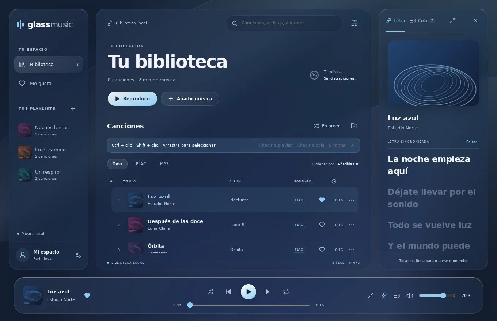

# Glass Music

Tu música local, a tu manera. Reproductor para Windows centrado en FLAC y MP3, con interfaz de vidrio ajustable y perfil local con nombre y foto. Sin registro, login ni telemetría.



## Alpha 0.4.0

- Azul **#8CCDF3** como color principal, incluido el icono de Windows. El logo de la interfaz sigue el color elegido.
- Ajustes por secciones: apariencia, perfil, reproductor, Discord y rendimiento.
- Escala de toda la interfaz: **Ctrl +**, **Ctrl −**, **Ctrl + rueda** y **Ctrl + 0**. Se guarda entre sesiones.
- Selección: **Ctrl + clic** para canciones separadas; clic en la primera y **Shift + clic** en la última para un rango; **Ctrl + A** para la lista filtrada; recuadro desde un espacio vacío o el margen izquierdo. La selección se puede arrastrar a playlists, añadir a la cola o quitar de la biblioteca con confirmación. Los archivos originales se conservan.
- Reproductor que aparece al acercar el mouse al borde inferior o llegar con Tab. Se puede dejar siempre visible.
- Volumen con barra más grande, valor exacto, panel ampliado, rueda, pasos configurables y recuperación del nivel previo al silenciar.
- Reloj aislado de la biblioteca, fondo preparado una vez por portada a baja resolución y perfiles Ahorro / Equilibrado / Máxima apariencia. El consumo debe medirse en Windows.
- Discord Rich Presence opcional. Requiere la configuración inicial indicada abajo.

## Alpha 0.1.2

Arrastra una canción desde la biblioteca, la cola o el reproductor hasta una playlist de la barra lateral. Se resalta el destino y se confirma al añadirla, sin duplicados. Dentro de una playlist, selecciona **Tu orden** para mover sus filas arrastrando. El menú de **clic derecho** aparece junto al cursor con reproducir, favoritas, cola, playlists, edición y quitar. También funciona con el botón de tres puntos y el teclado.

Interfaz rediseñada con cristal ahumado, fondo frío, reflejos, bordes de luz y reproductor flotante. Transiciones de paneles, menús, letras y cambios de canción; respuesta al pasar, pulsar y arrastrar. El indicador de reproducción se anima solo mientras suena música. **Reducir efectos** y la preferencia de movimiento reducido del sistema desactivan las animaciones. El color de acento que ya elegiste se conserva.

La actualización mantiene la biblioteca, las playlists y el perfil existentes.

## Alpha 0.1.1

Corrige el error `SeekError(Unseekable)` al adelantar o reanudar archivos FLAC. El decodificador conoce ahora el tamaño del archivo y habilita los saltos. Añade lectura de Enhanced LRC con tiempos por palabra y voces (`v1:`, `v3:`), limpiando las marcas también en letras ya importadas.

Para ampliar: toca la portada junto a los controles o el botón **Vista grande**. Alterna **Portada / Letra** arriba y usa **Esc** para volver. La vista sigue la canción actual, con los controles siempre disponibles. La biblioteca usa ahora la portada real y texto más legible.

## Funciones de la alpha

- Importación de archivos/carpetas; etiquetas y portadas integradas; evita volver a importar una misma ruta.
- Audio nativo en streaming con Rodio/Symphonia; reproducción, pausa, volumen, seek, anterior, siguiente y repetición.
- Biblioteca SQLite, búsqueda por título/artista/álbum, favoritos y lista virtualizada.
- Edición local de título, artista, invitados, álbum y portada; originales intactos.
- Letras integradas, LRC junto al audio y letras manuales; sincronización y salto por línea.
- Playlists con nombre, portada y orden propio.
- Cola editable, arrastrable y con flechas; reproducir después o agregar al final.
- Aleatorio sin repeticiones y mezcla que separa artistas cuando es posible.
- Perfil local, colores personalizados, día/noche y modo de efectos reducidos.

## Instalar en Windows

Descarga la versión publicada en **[Releases](https://github.com/Eaysix/glass-music/releases)** y ejecuta el instalador `*-setup.exe`. Para actualizar, cierra la app e instala en la misma ubicación: se conservan biblioteca, playlists y perfil.

Las compilaciones de desarrollo están en [Actions](https://github.com/Eaysix/glass-music/actions), en ejecuciones completadas correctamente de **Windows · comprobar y crear instalador**, artefacto **Glass-Music-Windows-x64**. Se generan solo si pasan las comprobaciones; no equivalen a una release publicada.

La alpha no está firmada con un certificado de distribución. Windows puede mostrar una advertencia de editor desconocido. El instalador utiliza WebView2; si falta, su instalación inicial puede requerir internet. La reproducción y los datos de la app funcionan sin internet.

## Inicio y organización

Al abrir, Inicio muestra tus playlists, la última canción para continuar manualmente, playlists escuchadas recientemente y accesos a Me gusta / Sin organizar cuando tienen contenido. Todas las canciones queda como colección secundaria. Una canción puede pertenecer a varias playlists sin duplicar el archivo.

Crea una playlist y usa **Añadir canciones** o **Importar carpeta** dentro de ella. Si seleccionas archivos ya importados se añaden a esa lista conservando sus ediciones. Quitar una canción de una playlist conserva las otras listas y el original. El ancho del panel de letras/cola se ajusta arrastrando su borde izquierdo o con las flechas al enfocarlo; doble clic restablece el ancho.

## Windows, teclado y Nusa

La versión Windows registra una sesión **System Media Transport Controls (SMTC)**: título, artista, álbum, portada local, duración, posición y estado. Los controles de Windows y las teclas multimedia envían play/pausa, siguiente, anterior y adelantar. Los botones de canción siguiente/anterior reflejan la cola de Glass Music. Se retira la sesión al cerrar y no inicia audio por sí sola al abrir.

Nusa consume las sesiones multimedia de Windows, así que esta es la vía de compatibilidad; hace falta verificarla en una sesión real con Nusa y el teclado del usuario. Nusa obtiene sus letras de LRCLIB. No hay una interfaz documentada para entregarle nuestras letras locales, y esta versión no las sube a ningún servicio. Una canción sin coincidencia en LRCLIB puede tener letra dentro de Glass Music y no en Nusa.

## Editor de letras

Desde **Editar letra**, escribe o pega un verso por línea. En **Sincronizar líneas**, reproduce la canción y pulsa **Marcar línea y seguir** al comenzar cada verso. Con el botón enfocado puedes usar Espacio. Puedes deshacer, corregir segundos manualmente y escuchar desde una línea marcada. Completa todos los tiempos en orden antes de guardar. Cancelar conserva la letra anterior; el audio original no se modifica. El LRC por palabra se conserva si solo lo importas y guardas; la sincronización manual genera tiempos por línea.

## Discord: configuración inicial del proyecto

La presencia se conecta al cliente local de Discord; no pide contraseña ni token. El propietario debe crear una aplicación llamada **Glass Music** en el [portal de Discord](https://discord.com/developers/applications), configurar su icono y aportar su **Application ID público**. Para la imagen de la actividad, sube también el logo en **Rich Presence → Art Assets** con el nombre exacto **`glass_music`**. Configurar solo el icono de Información general no completa este paso. La actividad ya fue observada por el usuario; la imagen del nuevo payload queda pendiente de confirmar en Discord real.

En esta alpha se introduce en **Ajustes → Discord**. Para distribuirlo listo para todos, se configura una sola vez `DISCORD_APPLICATION_ID` en `src/types.ts` antes de compilar. No es un secreto. Activa compartir actividad en Glass Music y en Discord; la conexión requiere Discord de escritorio. Al pausar o desactivar la opción se retira la actividad. Solo se envían título, artista, álbum opcional y tiempos. No se publican rutas, portadas locales ni letras.

## Desarrollo en Windows

Requisitos: Node.js 22.12+ (o 24 LTS), Rust estable y las herramientas C++ de Visual Studio (carga **Desarrollo para el escritorio con C++**), además de WebView2.

```powershell
npm ci
npm run tauri dev
```

Para compilar:

```powershell
npm test
npm run build
cargo test --locked --manifest-path src-tauri/Cargo.toml
npm run tauri build -- --bundles nsis
```

El instalador queda en `src-tauri/target/release/bundle/nsis/`. Para revisar solo la interfaz: `npm run dev`. Ese modo usa IndexedDB y HTML Audio dentro del navegador; no usa el motor nativo ni comparte su biblioteca.

## Pruebas de interfaz

```powershell
npx playwright install chromium
npm run test:ui
```

Este recorrido automatizado prueba importación FLAC/MP3, reproducción web, edición, letras, favoritas, playlists, cola, perfil/foto, temas, persistencia y la virtualización de 5.000 filas. Guarda capturas en `artifacts/` (fuera del repositorio). No sustituye la prueba del dispositivo de audio nativo.

## Datos y rendimiento

En Windows, SQLite y las portadas están bajo el directorio local de datos de la aplicación (`%LOCALAPPDATA%/com.eaysix.glassmusic`). El audio permanece en sus carpetas originales: no se copia a la biblioteca ni se carga entero en RAM. Las portadas se reducen a un máximo de 512 px. Las letras se cargan al seleccionar una canción. El estado de audio se consulta cada segundo (medio segundo en máxima apariencia), solo durante reproducción. El reloj actualiza únicamente sus controles suscritos y el cambio de línea; el fondo se prepara en un canvas de 32px por portada. Al pausar, el motor nativo libera el dispositivo y el decodificador; al reanudar abre el archivo en la posición guardada.

El modo reducido elimina desenfoques, sombras y transiciones. Todavía deben medirse RAM, CPU, GPU y arranque en una compilación release de Windows; no se afirma consumo cero, audio bit-perfect ni reproducción gapless.

## Límites actuales

- Alpha: verificar salida de audio y seek con tu colección y dispositivo en Windows.
- Los cambios de etiquetas y letras se guardan en la biblioteca: escribirlos al archivo y buscar letras online quedan para una versión posterior.
- Si mueves o renombras un archivo desde el Explorador, debes volver a importarlo; no hay relocalización automática. Duplicados por ruta, no por huella acústica.
- La cola y su orden persisten. La posición se guarda al pausar, adelantar o cerrar la app nativa, no en cada actualización; al abrir siempre empieza en pausa.
- El tema ofrece un fondo ambiental; elegir un fondo propio queda pendiente.
- Playlists sin duplicados internos. La cola sí admite añadir una canción otra vez explícitamente.
- No se han creado todavía las skills personalizadas propuestas.

[Requisitos y decisiones](docs/REQUISITOS.md) · [Pendientes](https://github.com/Eaysix/glass-music/issues)
